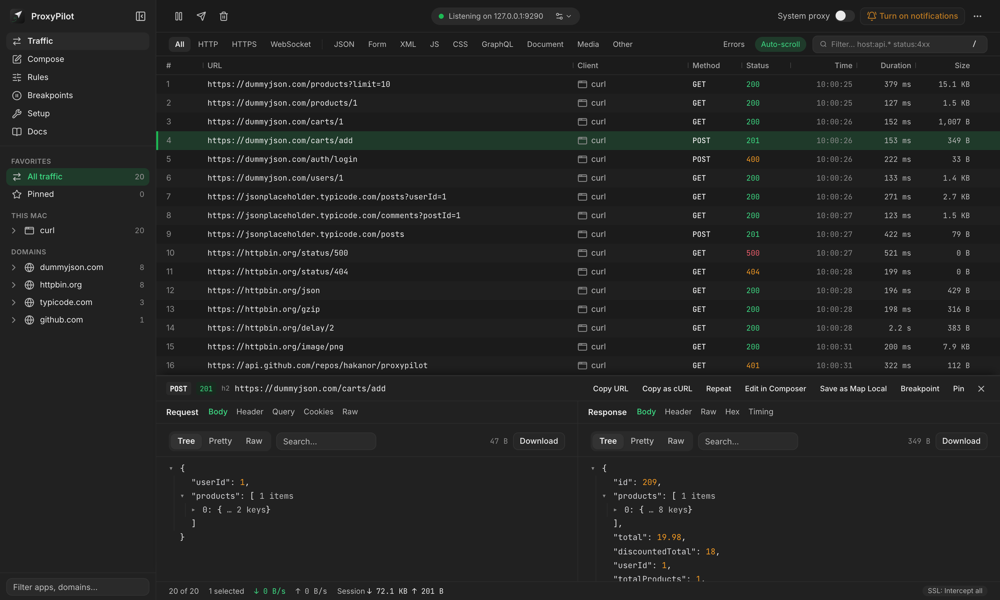

<p align="center">
  
</p>

<h1 align="center">ProxyPilot</h1>

<p align="center">An AI-ready HTTP(S) and WebSocket debugging proxy in a single Go binary. AI agents read and change traffic over MCP, humans use the built-in web UI, and scripts use a <code>--json</code> CLI.</p>

<p align="center"><code>brew install hakanor/tap/proxypilot</code></p>

<p align="center">
  
</p>

---

Capture, inspect and change traffic from iOS simulators and devices, Android emulators and devices, macOS apps and Chrome. The tool is similar to Proxyman or Charles. The web UI, the CLI and the MCP server all use the same control API, so a feature added there works everywhere.

## Features

- **Protocols:** HTTP/1.1 and HTTP/2 on both sides, WebSocket with every message recorded (permessage-deflate decoded).
- **Traffic:**
  - Live table with sortable columns.
  - Sidebar grouped by device → app → domain. iOS simulator traffic is detected from the client process.
  - Filters such as `host:` `status:` `method:` `type:`.
  - Detail panel with headers, body (JSON tree, hex), timing and GraphQL.
- **Rules:** Map Local, Map Remote, Rewrite (headers, query, body, JSON fields, status, URL) and Breakpoints. Rules can also be added from the right-click Tools menu on any request.
- **Breakpoints:** A paused request opens in a pop-up. You can edit it as a form, as raw HTTP or as JSON, then continue, abort or execute the edited version.
- **Compare:** Diff two requests side by side: query parameters, headers, status and JSON fields by path. Agents get the same as the `diff_flows` MCP tool.
- **Compose and Repeat:** Paste a cURL command or start from a recorded flow. Requests can be repeated N times with a set concurrency.
- **Setup helpers:**
  - Install the CA into iOS simulators and Android devices (adb).
  - Toggle the macOS system proxy.
  - Capture Chrome over DevTools.
  - Phone certificate page with a QR code.
- **Network:** Throttle profiles (EDGE, 3G, LTE, bad Wi-Fi, custom) per host, No caching, and opening the proxy to phones on your Wi-Fi from the toolbar.
- **Sessions:** HAR import and export, and `.proxypilot` session files.
- **Redaction:** Tokens, cookies and passwords are masked in CLI, export and MCP output by default.

## Quick start

Install a release (`curl -fsSL https://raw.githubusercontent.com/hakanor/proxypilot/main/install.sh | sh`, or `brew install hakanor/tap/proxypilot`), or build from source. The full walkthrough is [docs/quickstart.md](docs/quickstart.md).

Building from source needs Go 1.26+, and Node 20+ for the web UI.

```bash
make web        # build the Svelte UI into internal/api/webdist
make build      # build bin/proxypilot (the UI is embedded)
```

```bash
./bin/proxypilot ui       # start the daemon if needed and open the web UI
```

The proxy listens on `127.0.0.1:9090`. The control API and web UI are on `127.0.0.1:9091` and only accept local connections.

```bash
curl -x http://127.0.0.1:9090 http://example.com/
```

To capture HTTPS on this Mac, trust the root certificate. This asks for your password:

```bash
./bin/proxypilot trust
```

Then use **Setup** in the UI for simulators, devices and Chrome. `proxypilot system-proxy on` routes macOS apps through the proxy.

## CLI

```bash
proxypilot list --json            # captured flows, newest first
proxypilot tail                   # stream flows live
proxypilot show <id> --body       # one flow with bodies
proxypilot wait --url '*api*'     # block until a matching flow completes
proxypilot rule add breakpoint --url '*example.com*'
proxypilot curl <id>              # copy a flow as cURL
proxypilot uninstall              # undo system proxy and simulator CA changes
```

Every command is in [docs/cli.md](docs/cli.md); the JSON output is described in [docs/cli-json.md](docs/cli-json.md).

## AI agents (MCP)

```bash
claude mcp add -s user proxypilot -- proxypilot mcp --agent-name claude
```

Agents can list and search traffic, read bodies and WebSocket messages, add rules, resolve breakpoints and throttle the network. Setup: [docs/mcp.md](docs/mcp.md). How an agent should use it, with scenarios to copy into your project: [docs/AGENTS.md](docs/AGENTS.md).

## Development

| Path | What |
|---|---|
| `cmd/proxypilot` | CLI entry point |
| `internal/proxy` | MITM proxy, TLS, HTTP/1.1, WebSocket |
| `internal/capture`, `internal/store` | Recorder and SQLite store |
| `internal/rules`, `internal/breakpoints` | Rules engine and paused flows |
| `internal/api` | Control API (REST + WebSocket) and the embedded UI |
| `internal/mcpserver` | MCP server |
| `internal/brand` | App icon (source of truth) |
| `web/` | Svelte 5 + Tailwind v4 + shadcn-svelte UI |
| `docs/design` | App icon PNGs and the GitHub social preview |

**Commands:**
- `make test` runs the Go tests.
- `cd web && npm run check` type-checks the UI.
- `cd web && npm run dev` runs the UI with hot reload against a running daemon. Set `PROXYPILOT_TOKEN` first; see `web/vite.config.ts`.
- `make icons` re-exports the icon after you edit `internal/brand/icon.svg`.
- Tests that launch a real Chrome only run with `PROXYPILOT_CHROME_TEST=1`.

**Docs:**
- Users: [quickstart](docs/quickstart.md), [devices and troubleshooting](docs/devices.md), [CLI reference](docs/cli.md) (`make docs` regenerates it), [security](docs/security.md).
- Releases: `.goreleaser.yaml` and `install.sh`.
